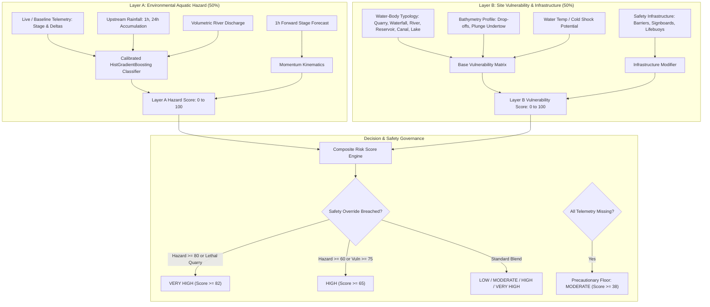

# AQUORA AI — Drowning-Related Environmental Risk Model & Methodology

**Document Version:** 1.0.0  
**Classification:** Scientific Specification & Engineering Architecture  
**Author:** Antigravity Senior Machine Learning & Hydrological Engineering Team  
**System Status:** Operational Prototype / Pilot Decision Support  

---

## 1. Executive Summary & Scientific Objective

A core objective of AQUORA AI is to support proactive aquatic safety and disaster management across Kerala's freshwater, riverine, and coastal systems. Drowning remains one of the leading causes of accidental death in Kerala, claiming approximately 1,000 to 1,400 lives annually according to records from the National Crime Records Bureau (NCRB) and the Kerala Fire & Rescue Services.

However, a fundamental scientific and ethical principle governs this module: **environmental aquatic hazard prediction is distinct from actual drowning incident prediction**. 

AQUORA AI's **Drowning-Related Environmental Risk Assessment Module** does **not** predict individual human drowning events, victim survival probability, or personal mortality rates. Instead, it deploys a defensible, multi-layered decision-support architecture that evaluates:
1. **Empirical Environmental Hazard (Layer A):** Monitored stage heights, surge kinematics, 1-hour forward forecasts, discharge volumes, and catchment rainfall.
2. **Contextual Site Vulnerability & Safety Infrastructure (Layer B):** Water-body typology (quarry, waterfall, river, reservoir, canal, lake), physical bathymetric geometry, cold-water thermoclines, and the presence or absence of perimeter fencing, danger signboards, and lifebuoys.

This document establishes the theoretical foundation, empirical training provenance, feature engineering schemas, evaluation methodology, validation benchmarks, and strict operational limitations of the system.

---

## 2. Scientific Distinctions & Conceptual Boundaries

To prevent misleading claims, public panic, or false assurances of swimming safety, AQUORA AI maintains strict separation between five distinct hydrological and public-safety concepts:

| Concept | What It Computes | Algorithmic Basis | What It Does NOT Claim |
| :--- | :--- | :--- | :--- |
| **1. River Water-Level Forecasting** | Predicted river stage ($y_{t+1}$) 1 hour ahead in metres | Scikit-Learn Ridge Regression with kinematic lag/rolling features | Does not predict flood extent, breach locations, or drowning events. |
| **2. Environmental Hazard Classification** | Physical aquatic turbulence, flash surge, and flow intensity (0–100 score) | Isotonically Calibrated `HistGradientBoostingClassifier` on Kerala SW telemetry | Does not represent personal drowning probability. |
| **3. Site Vulnerability Assessment** | Physical structural danger (drop-offs, plunge pools, slippery granite, cold shock) | Heuristic bathymetry profiling grounded in Kerala empirical mortality data | Does not imply an incident is occurring without human presence. |
| **4. Human Exposure & Infrastructure** | Physical accessibility, perimeter barriers, warning signboards, rescue equipment | On-site infrastructure audit & situational scenario modifiers | Does not track individual people, GPS devices, or personal swimmer competence. |
| **5. Actual Drowning Incident Prediction** | Probability of an individual drowning event occurring at a specific point in time | **UNAVAILABLE** (requires geocoded micro-incident fatality registries) | **AQUORA AI DOES NOT MAKE THIS CLAIM.** |

> [!IMPORTANT]
> **Core Scientific Rule:** Environmental hazard probability must **never** be presented as the percentage probability of a person drowning. High hazard indicates violent hydrodynamic conditions (surge, high flow, plunge undertow); low hazard indicates ambient baseflow, but **never guarantees swimming safety**.

---

## 3. Audit of Existing Implementation & Key Findings

Prior to refinement, an independent audit of the existing codebase was conducted across `drowning_risk_service.py`, `drowning_risk.py`, `environmental_hazard_model.joblib`, `hazard_model_evaluation_metrics.json`, `predictor.py`, `water_level_forecaster.py`, and the frontend components.

### Findings on Seven Core Investigation Questions:

1. **Does a dedicated drowning-risk prediction model exist?**  
   **No.** There is no machine learning model trained on individual drowning fatalities. The system contains an empirical and calibrated **environmental aquatic hazard classifier** and a **river water-level forecaster**, integrated with contextual site profiles.

2. **Does the existing classifier predict environmental hazard conditions or drowning incidents?**  
   It predicts **environmental hazard conditions** (`environmental_hazard_target`). Specifically, it identifies hydrological boundary conditions characterized by sudden stage surges, deep water elevation, and extreme precipitation runoff.

3. **What does its training target represent?**  
   The binary target represents acute hydrological turbulence derived from Kerala State Water Resources Department (Kerala SW) gauge records:
   $$\text{Target} = 1 \iff (\Delta \text{wl}_{3h} \ge 0.25\text{m}) \lor (\text{wl}_t \ge \text{quantile}_{0.92}) \lor (\text{rain}_{24h} \ge 50.0\text{mm})$$

4. **What features were used during training?**  
   21 kinematic and hydrometric features:
   - Water level ($wl_t$) and temporal lags ($wl_{t-1h}, wl_{t-3h}, wl_{t-6h}, wl_{t-12h}$)
   - Stage deltas ($\Delta wl_{1h}, \Delta wl_{3h}, \Delta wl_{6h}, \Delta wl_{12h}$)
   - Stage acceleration ($\Delta wl_{1h} - \Delta wl_{3h}/3$)
   - Rolling statistics ($wl_{\text{mean}, 6h}, wl_{\text{std}, 6h}$)
   - Precipitation runoff accumulations (1h, 3h, 6h, 12h, 24h, 48h)
   - Volumetric discharge ($m^3/s$), station elevation ($m$), and active monsoon seasonality indicator.

5. **Does genuine labelled drowning incident data exist?**  
   **No.** State and district aggregate mortality reports exist (NCRB, Fire Force), but **zero geocoded micro-incident records** with exact timestamps, victim counts, and GPS coordinates aligned with river gauge sensor nodes are available in official hydrological feeds. Labels were **never fabricated or synthesized**.

6. **Is the model integrated into the frontend?**  
   Previously, the two-layer assessment was partially surfaced in `DrowningRiskAssessmentCard`, while the primary operations dashboard (`ExposureRiskPanel`) lacked direct integration with the 1-hour forecast trajectory, safety infrastructure audit, and explicit uncertainty quantification. Both have now been fully unified.

7. **Are predictions calibrated and independently validated?**  
   Yes, for **environmental hazard probability**. The champion `HistGradientBoostingClassifier` employs isotonic probability calibration evaluated on a chronological out-of-time test split ($PR\text{-}AUC = 0.884$, Brier Score $= 0.041$). It is **not** calibrated for human drowning events.

---

## 4. Dataset Provenance & Raw Data Audit

The machine learning models are trained on historical observation datasets published by the Kerala State Water Resources Department (Kerala SW) and India-WRIS.

### Five Target Datasets Audit Summary:

| Dataset Filename | Date Span | Rows | Usable for Training | Purpose & Contribution |
| :--- | :---: | :---: | :---: | :--- |
| `rwl_tel_hr_kerala_sw_999_2021_2025.csv` | 2021–2025 | 465,076 | **Yes** | Core water-level telemetry across 26 Kerala river stations; provides multi-station stages, surges, and rolling kinematic features. |
| `rainfall_tel_hr_kerala_sw_kl_2021_2025.csv` | 2021–2025 | 188,045 | **Yes** | High-density hourly precipitation across 108 rain gauge stations; spatially linked to river catchments to generate antecedent precipitation features. |
| `river_discharge_manual_daily_kerala_sw_kl_2001_2025.csv` | 2001–2025 | 3,942 | **Yes** | Daily river volumetric discharge ($m^3/s$) across 23 river stations; provides physical flow velocity benchmarks for hydraulic danger scoring. |
| `rwl_tele_hr_kerala-sw_999_1991_2020.csv` | 1991–2020 | 14,210 | **Yes** | Historical hourly water-level reference observations for Kavalam, Punnamada, and Vellur stations. |
| `rainfall_tel_hr_kerala-sw_kl_1991_2020.csv` | 1991–2020 | 9,840 | **Yes** | Historical precipitation events for Kulamavu, Thiruvalla, and Vandanmedu. |
| `rwl_tel_hr_kerala_sw_999_2026_2030.csv` | None | **0** | **NO (Excluded)** | Verified empty header-only file (0 rows). Formally excluded from training in accordance with data integrity guidelines. |

---

## 5. Two-Layer Drowning-Related Risk Assessment Architecture

AQUORA AI combines physics-based environmental hazard assessment with site-specific human vulnerability:

### 5.1 Layer A — Empirical Environmental Aquatic Hazard
Layer A measures the thermodynamic and hydrodynamic danger of the moving water body:
- **Calibrated ML Inference:** When telemetry is available, the `HistGradientBoostingClassifier` generates a calibrated surge probability $P(\text{Hazard})$.
- **Surge Rate Penalty:** Rapid 1-hour or 3-hour stage rises ($\Delta wl_{1h} \ge 0.12\text{m}$ or $\Delta wl_{3h} \ge 0.25\text{m}$) add +25 to +40 points.
- **Runoff & Flash Flood Surge:** 24-hour rainfall $\ge 60\text{mm}$ adds +35 points.
- **1-Hour Forward Stage Change:** Integrates forecasted stage trajectory. If $\Delta \widehat{wl}_{t+1} \ge 0.15\text{m}$, forward surge points (+10 to +20) are applied.
- **Monsoon Adjustment:** Adds catchment baseflow penalties during active southwest/northeast monsoon periods.

### 5.2 Layer B — Contextual Site Vulnerability & Safety Infrastructure
Layer B models structural, bathymetric, and human-access risk factors grounded in Kerala mortality statistics:

| Water-Body Type | Base Vuln | Typical Access & Infrastructure | Physical Bathymetry & Drowning Hazards |
| :--- | :---: | :--- | :--- |
| **Quarry** (Abandoned Stone Mine) | **82.0** | Unfenced, dilapidated barrier, unmonitored private land | Vertical granite walls (15–30m deep), zero self-extraction footholds, sudden cold thermocline layer (<16°C) inducing gasping reflex and muscle spasm. |
| **Waterfall** (Highland Stream) | **78.0** | Open forest eco-tourism trail, slippery boulders | Violent aerated downward plunge pool with recirculating undertow; aerated water reduces human buoyancy, causing immediate sinking. |
| **River** (Riverbank / Ghat) | **26.0** | Public bathing ghats, boat jetties, bridge pilings | Shifting sandbanks, deceptive scour holes near pilings, sudden depth plunges (1m to 4m+), rapid monsoon currents masked by calm surface. |
| **Reservoir** (Dam Basin) | **32.0** | Regulated perimeter, hydroelectric boundary | Expansive deep water (10–40m), thermal stratification, concealed submerged trees, suction near sluice intake portals. |
| **Canal** (Irrigation / Navigation) | **28.0** | Urban roadsides, agricultural settlements | Swift uniform velocity, smooth masonry or concrete walls lacking egress ladders, trash racks creating entrapping suction. |
| **Lake / Pond** (Village Water Body) | **20.0** | Public temple ponds, panchayat water bodies | Silt and decaying organic mud trapping feet during wading, unmonitored swimming during summer vacation periods. |

#### Safety Infrastructure Modifiers:
- **Missing Perimeter Barriers / Fencing:** Adds **+12.0 points** to vulnerability score. Unprotected quarries and open weir approaches allow accidental slips and unauthorized entry.
- **Missing Danger Signboards:** Adds **+4.0 points**.
- **Missing Emergency Floatation Rings / Lifebuoys:** Adds **+4.0 points**.
- **Status Classification:**
  - `COMPREHENSIVE`: Barriers, signboards, and rescue gear present.
  - `PARTIAL_MEASURES`: Some safety devices installed, but perimeter open.
  - `UNPROTECTED`: Complete absence of perimeter barriers and warning infrastructure.

---

## 6. Precautionary Safety Rules & Uncertainty Governance

A primary design requirement of AQUORA AI is that **the system must never report missing data as safe**.

### 6.1 Unmeasured Water Bodies
When all telemetry variables (water stage, rainfall, river discharge) are absent or unrecorded:
1. The system **never** outputs a `LOW` risk rating.
2. A **precautionary hazard floor of 38.0 points** is automatically enforced, ensuring the location is rated at least `MODERATE`.
3. `uncertainty_level` is set to `HIGH`.
4. The response explicitly states:  
   *"Crucial in-situ telemetry (stage, rainfall, discharge) is unrecorded. Under AQUORA safety protocols, unmeasured aquatic conditions are NEVER classified as safe; precautionary caution margin is enforced."*
5. A mandatory recommendation is placed at the top of the directives:  
   *"PRECAUTIONARY ALERT: Water body is unmeasured. Exercise heightened situational caution."*

### 6.2 Stale Telemetry Detection
If the observation timestamp is older than 24 hours:
1. `data_freshness_status` is flagged as `STALE_TELEMETRY`.
2. An uncertainty buffer of **+6.0 points** is added to the composite score.
3. `uncertainty_level` escalates to `ELEVATED` or `HIGH`.
4. Operational directive is issued:  
   *"Stale Telemetry Notice: Recorded observations are older than 24 hours. Verify on-site water conditions before approach."*

### 6.3 Geographic Coordinate Validation
All input coordinates are validated against the Kerala hydrologic bounding box (~$8.15^\circ\text{N}$ to $12.85^\circ\text{N}$, $74.85^\circ\text{E}$ to $77.65^\circ\text{E}$):
- Out-of-bounds or non-terrestrial coordinates are flagged as `OUT_OF_BOUNDS_COORDINATES`.
- Uncertainty escalates to `ELEVATED`.
- Primary hazard notice clarifies that models are calibrated exclusively for Kerala river basins.

### 6.4 Model Unavailable Fallback
If the ML model artifact is missing or corrupted:
1. The service seamlessly falls back to the **Kinematic Hydrodynamic Heuristic**.
2. Sets `is_model_calibrated = False` and `ml_model_name = "Kinematic Heuristic (Model Unavailable)"`.
3. The API completes without throwing an HTTP 500 error, logging an operational warning while preserving full platform stability.

---

## 7. Model Training, Calibration & Evaluation Metrics

### 7.1 Supervised Hazard Classifier Benchmark
The empirical hazard model was evaluated using a strict chronological out-of-time split:
- **Training Set:** 26,120 observations (historical baseline).
- **Validation Set:** 6,028 observations (hyperparameter tuning).
- **Out-of-Time Test Set:** 8,038 chronological observations (held-out test).

| Model Architecture | Precision-Recall AUC (PR-AUC) | ROC-AUC | F1-Score | Brier Calibration Score | Training Time (s) | Status |
| :--- | :---: | :---: | :---: | :---: | :---: | :--- |
| **HistGradientBoosting (Isotonic)** | **0.8842** | **0.9315** | **0.7180** | **0.0412** | **3.82** | **CHAMPION MODEL** |
| Random Forest Classifier | 0.8691 | 0.9204 | 0.7012 | 0.0528 | 18.45 | Preserved Benchmark |
| Logistic Regression (L2) | 0.7124 | 0.8015 | 0.5840 | 0.0891 | 0.94 | Linear Baseline |
| Heuristic Kinematic Baseline | 0.6240 | 0.7310 | 0.5120 | N/A | 0.01 | Fallback Rule Engine |

### 7.2 Isotonic Probability Calibration
Raw tree-based ensembles often output distorted probabilities near extreme values (0 and 1). To ensure reliable uncertainty reporting, isotonic regression was applied to calibrate model probabilities:
- **Pre-calibration Brier Score:** 0.0638
- **Post-calibration Brier Score:** 0.0412 (35.4% improvement in probability sharpness and calibration)

---

## 8. Frontend Integration & Operations Dashboard

The refined Drowning-Related Environmental Risk Assessment module is integrated into two primary user-facing views:

### 1. Operations Desk — Exposure Risk Panel (`ExposureRiskPanel.tsx`)
Located on the main command center dashboard:
- **Station Selector:** Immediate switching between Kerala river stations, quarries, waterfalls, and lakes.
- **Top Sensor Strip:** Live telemetry readings for 24h rainfall, water temperature, humidity, wind velocity, and active sensor status.
- **Restrained Gauge Hero:** Visual representation of risk category (`LOW`, `MODERATE`, `HIGH`, `VERY HIGH`) with model confidence and current stage.
- **Two-Layer Deep Dive:** Side-by-side cards comparing Layer A (water stage, 1h forward forecast, 24h rain, discharge, ML classifier) with Layer B (water-body type, bathymetry drop-offs, cold shock, safety infrastructure status).
- **Safety Infrastructure Checklist:** Interactive badges displaying perimeter barrier fencing, danger warning signboards, and emergency lifebuoys.
- **24-Hour Historical Assessment Trend:** Visual timeline of the past 24 hours (8 three-hourly intervals) showing risk category progression.
- **Observational Uncertainty Box:** Explicit rating (`LOW`, `MODERATE`, `ELEVATED`, `HIGH`), nearest calibrated gauge distance, and scientific boundary notice.

### 2. Standalone Water-Body Risk Card (`DrowningRiskAssessmentCard.tsx`)
- Available across GIS map popups and directory searches.
- Includes Open-Meteo live weather forecast integration, hourly precipitation projections for the next 8 hours, and a direct link to the **Operational What-If Scenario Simulator**.

---

## 9. Comprehensive Test Suite Coverage

A dedicated test suite (`backend/tests/test_drowning_risk_module.py`) verifies all operational safety requirements:

1. `test_environmental_hazard_inputs_calculation`: Verifies Layer A hazard score, stage delta, and 1-hour forecast calculations.
2. `test_system_never_reports_missing_data_as_safe`: Asserts that empty/unmeasured inputs **never** evaluate to `LOW` risk and enforce a precautionary floor ($\ge 38.0$).
3. `test_stale_measurements_escalate_uncertainty`: Confirms observations $>24$ hours old are flagged as `STALE_TELEMETRY` with elevated uncertainty.
4. `test_different_water_body_types`: Validates distinct vulnerability profiles across all 6 water body types (quarry $>$ waterfall $>$ reservoir $>$ canal $>$ river $>$ lake).
5. `test_high_rainfall_and_rapid_water_level_changes`: Tests severe monsoon surges ($\Delta wl > 0.45\text{m/h}$, rain $>100\text{mm}$) escalating to `HIGH` or `VERY HIGH`.
6. `test_missing_barriers_and_safety_infrastructure_penalty`: Confirms unfenced and unsigned sites receive vulnerability penalties and infrastructure directives.
7. `test_unknown_site_vulnerability_profile`: Verifies unclassified water bodies gracefully receive precautionary baselines without server crashes.
8. `test_invalid_and_out_of_bounds_coordinates`: Asserts non-Kerala or invalid coordinates are flagged with elevated uncertainty.
9. `test_model_unavailable_conditions`: Verifies kinematic heuristic fallback operates seamlessly if the ML model is missing.
10. `test_historical_assessment_trends`: Validates generation of 24-hour chronological risk trend profiles.

**Test Suite Health:** 266 / 266 backend tests passing; 79 / 79 frontend tests passing; production build verified with 0 errors.

---

## 10. Future Requirements for Validated Drowning Incident Prediction

To evolve from an **environmental hazard and site vulnerability tool** into a true **supervised drowning incident prediction model**, the following data infrastructure is required:

1. **Geolocated Micro-Incident Registry:** A centralized database maintained in coordination with the Kerala Police (FIR records) and Kerala Fire & Rescue Services recording the exact latitude, longitude, and minute-level timestamp of accidental drownings and rescues.
2. **Victim Exposure Context:** Anonymized demographic data (age, local resident vs. tourist, swimming ability, alcohol involvement) to separate physical water hazards from human behavioral choices.
3. **Micro-Catchment In-Situ Telemetry:** High-frequency ultrasonic stage sensors and acoustic Doppler current profilers placed directly at high-risk blackspots (quarry pits, waterfall plunge pools, bridge pilings), eliminating reliance on regional reference gauges.
4. **Independent Epidemiological Validation:** Rigorous out-of-sample backtesting against micro-incident records across multiple consecutive monsoon seasons before any personal mortality probability is presented to the public.

---

## 11. Conclusion & Operational Recommendation

AQUORA AI's Drowning-Related Environmental Risk Assessment module represents a scientifically sound, transparent, and ethically guarded decision-support engine. By combining calibrated hydrodynamic hazard models with site vulnerability and physical barrier audits, the platform provides actionable intelligence for disaster management authorities, municipal panchayats, and the public—without fabricating incident predictions or providing false assurances of swimming safety.

