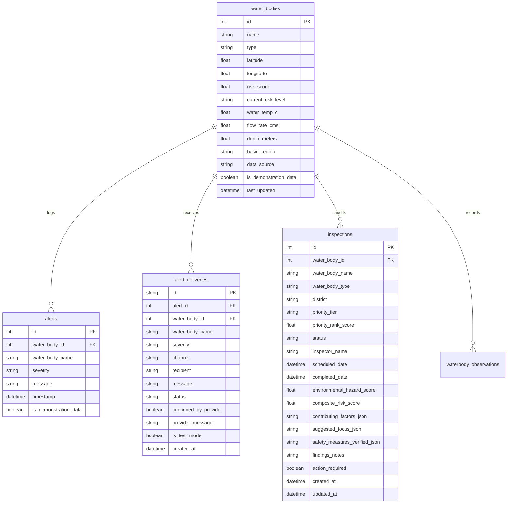

# AQUORA AI — System Architecture & Implementation Reference

**System:** AQUORA AI — Environmental Hazard Assessment & Decision-Support System  
**Academic Context:** Final-Year B.Tech Computer Science & Engineering Capstone Project  
**Repository State:** Production-Ready Modular Monolith (FastAPI + React 19)

---

## 1. System Overview

AQUORA AI is an intelligent environmental hazard assessment and safety decision-support platform designed for Kerala water bodies. The platform ingests real-time and historical hydrological telemetry from Central Water Commission (CWC) and Kerala State Water Resources Department (Kerala SW) monitoring stations, integrates live Open-Meteo meteorological streams, executes 1-hour-ahead machine learning river stage forecasting using scikit-learn Ridge Regression, runs a calibrated two-layer hydrodynamic and contextual site vulnerability scoring engine, and provides multi-channel outbound emergency alerts and municipal inspection governance.

```
+---------------------------------------------------------------------------------------------------+
|                                    AQUORA AI ARCHITECTURE                                         |
+---------------------------------------------------------------------------------------------------+
|                                                                                                   |
|  FRONTEND LAYER (React 19 + TypeScript + Vite + Tailwind CSS + Leaflet & OSM)                    |
|  +---------------------------------------------------------------------------------------------+  |
|  | - Operations Desk / Command Center (Overview, Exposure Risk, Actions Console, Map, What-If) |  |
|  | - Interactive Leaflet GIS Map with Risk Dots & Haversine Distance Trajectory                 |  |
|  | - River Stage Forecast Panel (Observed vs 1h Forward Forecast with Metrics)                  |  |
|  | - Municipal Site Inspection Ledger & Alert Dispatch Form                                    |  |
|  +---------------------------------------------------------------------------------------------+  |
|                                              | HTTP REST / JSON                                   |
|                                              v                                                    |
|  BACKEND API LAYER (Python 3.11 + FastAPI + Pydantic v2 + SQLAlchemy 2.0)                         |
|  +---------------------------------------------------------------------------------------------+  |
|  | [Routes /api/v1]                                                                            |  |
|  |  - /health                        : Health telemetry & service status                       |  |
|  |  - /water-bodies & /waterbodies   : GIS directory, search, nearby Haversine, GeoJSON        |  |
|  |  - /drowning-risk                 : Two-layer hazard scoring, What-If simulation            |  |
|  |  - /river-data                    : 1h Ridge forecasting, 24h history, forecast-vs-actual   |  |
|  |  - /weather/live                  : Open-Meteo live meteorology with TTL cache              |  |
|  |  - /authority/inspections         : Municipal inspection CRUD, triage ranking, trends       |  |
|  |  - /alerts & /monitoring          : Outbound delivery (Webhook/SMTP/Twilio), sweep worker   |  |
|  +---------------------------------------------------------------------------------------------+  |
|         |                                      |                                  |               |
|         v                                      v                                  v               |
|  +---------------------+             +---------------------+            +---------------------+   |
|  | ML FORECASTING      |             | TWO-LAYER HAZARD    |            | RELATIONAL DATABASE |   |
|  | Ridge Regression    |             | Layer A: Hydro      |            | SQLite (aquora.db)  |   |
|  | 25 Kinematic Deltas |             | Layer B: Context    |            | Alembic Migrations  |   |
|  | 1h Forward Horizon  |             | Uncertainty Penalty |            | Models: WB, Alert,  |   |
|  | Baseline Benchmark  |             | No Fake Probability |            | Delivery, Inspection|   |
|  +---------------------+             +---------------------+            +---------------------+   |
+---------------------------------------------------------------------------------------------------+
```

---

## 2. Core Subsystems

### 2.1 Two-Layer Environmental Hazard Engine
AQUORA AI strictly separates objective physical water behavior from site vulnerability:
1. **Layer A — Environmental Hydrodynamic Hazard (0–100):**
   - Evaluates water depth, velocity, discharge surges, rapid water-level delta ($\Delta h \ge 0.15\text{ m/h}$), and thermal shock potential ($T < 16^\circ\text{C}$).
2. **Layer B — Contextual Site Vulnerability (0–100):**
   - Evaluates structural features based on typology: steep sheer drops in abandoned quarry pits, turbulent plunge pools at waterfall bases, slippery ghat access steps, and absence of perimeter fencing.
3. **Observational Uncertainty Adjustment:**
   - When telemetry is unmonitored, stale, or distant from the nearest gauge station ($> 25\text{ km}$), an explicit penalty (+15 points) is added. Missing data is never treated as safe.

### 2.2 Machine Learning Forecasting Subsystem
- **Algorithm:** scikit-learn Ridge Regression (`Ridge(alpha=100.0)`).
- **Target:** 1-hour-ahead river water level (stage in meters, $h_{t+1}$).
- **Input Features (25):** 13 historical stage observations ($h_t, h_{t-1}, \dots, h_{t-12}$), 11 first-order kinematic stage deltas ($\Delta h_t = h_t - h_{t-1}$), and 1 acceleration term ($\Delta^2 h_t$).
- **Dam Rejection Safety Interlock:** Stations classified as dam barrages (e.g. Maniyar Dam) are rejected from kinematic forecasting because mechanical sluice operations invalidate physical kinematic flow models ($R^2 = -8.53$).

### 2.3 GIS & Waterbody Directory Subsystem
- Built using OpenStreetMap and Kerala Water Resources Department datasets.
- Implements spherical Haversine geodesic calculations (`backend/app/core/geospatial.py`) for live browser GPS distance and nearest-station discovery.
- Provides vector bounding-box queries (`/waterbodies/viewport`) and polygon/linestring feature representation.

### 2.4 Inspection Prioritization & Persistence Subsystem
- **Triage Algorithm:** Ranks monitored and unmonitored sites into four priority tiers:
  - `CRITICAL` (Score $\ge 75$ or high-risk quarry pits)
  - `HIGH` (Score $60 - 74$)
  - `MEDIUM` (Score $40 - 59$)
  - `ROUTINE` (Score $< 40$)
- **Database Model:** `InspectionRecordModel` mapped to table `inspections` with foreign key relationships, audit checklists, remediation flags, and lifecycle status (`SCHEDULED`, `IN_PROGRESS`, `COMPLETED`, `CANCELLED`).
- **Database Migrations:** Managed through Alembic (`dfd0da3e179f` baseline -> `32f7cdf14f88` inspections & vector tables).
- **Longitudinal Trend Rule:** Requires $\ge 5$ completed database records before projecting longitudinal trends. Displays truthful disclaimer when $N < 5$.

### 2.5 Outbound Alerts & Automated Monitoring
- **Provider Abstraction:** Unified `AlertService` managing Webhook (JSON HTTP POST), Email (SMTP), and SMS (Twilio).
- **Deduplication:** Enforces a configurable cooldown window (default: 30 minutes) per location and severity to prevent alert storms.
- **Test Mode Interlock:** Default safe mode logs dispatches to the database table `alert_deliveries` with status `TEST_MODE_SIMULATED` without broadcasting external network messages.

---

## 3. Database Schema & Alembic Revisions



### Migration History
1. `dfd0da3e179f`: Initial baseline schema (`water_bodies`, `alerts`, `alert_deliveries`, `alembic_version`).
2. `32f7cdf14f88`: Added `inspections`, `mapped_waterbodies`, `waterbody_observations`, and associated relational indexes.

---

## 4. Frontend Architecture & Design Philosophy

The user interface follows a natural, colourful light theme designed for mission-critical monitoring clarity:
- **Palette Tokens:** `#F8FAFC` (Canvas), `#FFFFFF` (Surface Cards), `#1677D2` (Primary Brand Blue), `#16A34A` (Mint / Safe Green), `#F59E0B` (Amber / Warning), `#DC2626` (Coral / Hazard Red), `#172B4D` (Heading Navy), `#64748B` (Muted Slate).
- Strictly **zero dark theme**, **zero black cards**, and **zero neon styling**.
- Responsive layout with desktop dual-desk navigation and mobile slide-out navigation drawers.
