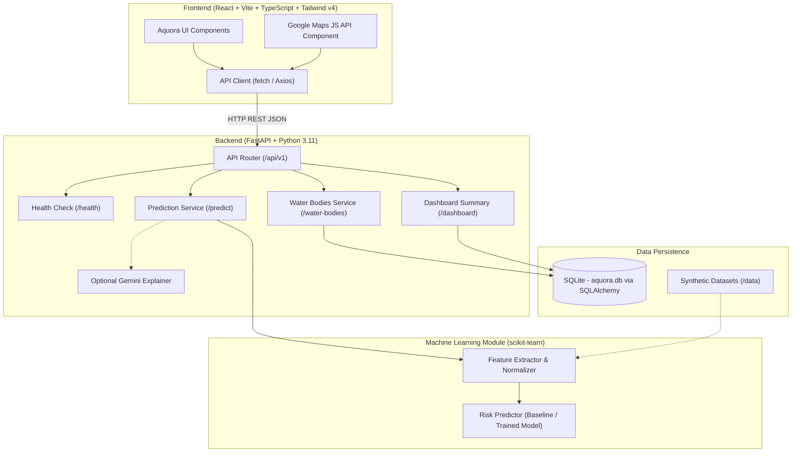

# AQUORA AI — System Architecture & Design

## 1. Project Overview
**AQUORA AI** is an intelligent water safety and risk monitoring platform designed for real-time hazard assessment, environmental metric tracking, and predictive water safety advisories for lakes, rivers, reservoirs, and coastal zones.

> **Hackathon Ethics & Data Notice:**
> - All environmental statistics and risk indicator datasets used during early-stage prototyping are **synthetic/simulated test data**.
> - Real drowning incidents or emergency telemetry are never fabricated.
> - The machine learning model is designated as **pre-training / baseline heuristic** until data collection and model training milestones are validated by the ML lead.

---

## 2. Technology Stack

| Layer | Technology | Primary Purpose |
| :--- | :--- | :--- |
| **Frontend** | React + Vite + TypeScript | Interactive UI, state management, and component architecture |
| **Styling** | Tailwind CSS v4 | High-performance modern utility-first design system via Vite plugin |
| **Mapping** | Google Maps JavaScript API | Geospatial visualization of water bodies, heatmaps, and hazard pins |
| **Backend** | Python (FastAPI) | High-speed asynchronous RESTful API service & request validation |
| **Validation** | Pydantic v2 | Data contract schemas and strict payload serialization |
| **Database** | SQLite + SQLAlchemy ORM | Lightweight, zero-config relational storage for water bodies & logs |
| **ML Engine** | Python + scikit-learn | Risk scoring algorithms, feature engineering, and predictive pipelines |
| **AI Insights** | Google Gemini API (Optional) | Plain-language safety explanations and advisory summaries |
| **VCS** | Git & GitHub | Modular collaboration and version control |

---

## 3. High-Level Architecture Diagram



---

## 4. Module Boundaries & Team Ownership

The repository is structured to enable independent, modular development across three core tracks:

```
Aquora_AI/
├── frontend/               # Track 2: Owned by Team Member 2 (Frontend & Map Lead)
│   ├── src/
│   │   ├── components/     # UI widgets, map wrapper, cards, charts
│   │   ├── services/       # API integration client
│   │   ├── types/          # TypeScript interfaces (mirrors api-contract.md)
│   │   └── App.tsx
│   ├── package.json
│   └── vite.config.ts
├── backend/                # Track 3: Owned by Team Member 3 (Backend & DB Lead)
│   ├── app/
│   │   ├── api/            # Route controllers (/health, /water-bodies, etc.)
│   │   ├── core/           # Config, CORS settings, database session
│   │   ├── db/             # SQLite connection and session factory
│   │   ├── models/         # SQLAlchemy ORM models
│   │   ├── schemas/        # Pydantic schemas (strictly enforces API contract)
│   │   └── main.py         # FastAPI application entry point
│   ├── requirements.txt
│   └── run.py
├── backend/app/ml/         # Track 1: Owned by Project Lead (ML & Integration Lead)
│   ├── features.py         # Environmental feature definitions
│   ├── model.py            # Model training & inference wrapper
│   └── pipeline.py         # Prediction pipeline integrating into FastAPI
├── data/                   # Track 1 & 3: Raw synthetic benchmarks & processed sets
│   ├── raw/
│   └── processed/
├── docs/                   # Shared Documentation & Specifications
│   ├── architecture.md
│   └── api-contract.md
├── .env.example            # Environment variables specification
├── .gitignore
└── README.md
```

### Team Responsibilities:
1. **ML Module & Final Integration Lead (You):**
   - Owns `backend/app/ml/`, feature definitions, synthetic data pipeline (`data/`), model training with scikit-learn, evaluation, and end-to-end integration verification.
2. **Frontend & Map Lead (Team Member 2):**
   - Owns `frontend/`, React components, Google Maps JS integration, Tailwind CSS v4 layout, accessibility, and client API communication.
3. **Backend & Database Lead (Team Member 3):**
   - Owns `backend/app/api/`, `backend/app/models/`, `backend/app/db/`, SQLite schemas, CRUD endpoints, and query optimization.

---

## 5. Security & Secret Management Principles
- **Zero Credentials in Code:** Never commit `.env` files or API keys (Google Maps, Gemini, DB credentials).
- **Public vs. Private Variables:**
  - Frontend variables must be prefixed with `VITE_` and must only contain public client keys (e.g., Google Maps API key restricted to HTTP referrers).
  - Private tokens (e.g., `GEMINI_API_KEY`) must reside strictly on the backend and never be transmitted to the browser.
