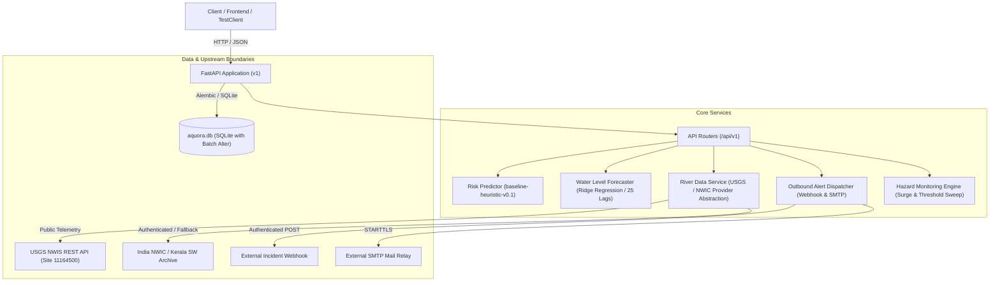

# AQUORA AI — Backend Integration QA & Upstream Safety Report

This technical report documents the backend integration boundaries, API contract compliance, automated test suite results, telemetry safety controls, and delivery audit verification for the AQUORA AI platform.

---

## 1. Backend Components & Integration Boundaries



---

## 2. Endpoints & Workflows Tested

All endpoints adhere strictly to `docs/api-contract.md`:

| Endpoint | Method | Component / Workflow | Integration Boundary | Verified Status |
|---|---|---|---|---|
| `/api/v1/health` | GET | System Health & Diagnostic | DB connectivity & ML loader | Verified (`200 OK`) |
| `/api/v1/water-bodies` | GET | Monitored Zones Directory | SQLite (`WaterBodyModel`) | Verified (`200 OK`) |
| `/api/v1/water-bodies/{id}` | GET | Single Station Lookup | SQLite (`WaterBodyModel`) | Verified (`200 OK` / `404 Not Found`) |
| `/api/v1/water-bodies/by-coordinates` | GET | Proximity Station Match | Haversine distance over SQLite | Verified (`200 OK` / `404 Not Found`) |
| `/api/v1/predict` | POST | Water Safety & Risk Prediction | `baseline-heuristic-v0.1` | Verified (`200 OK` / `422 Unprocessable`) |
| `/api/v1/forecast/water-level` | POST | 1-Hour Stage Forecasting | Ridge Regressor (25 Lags) | Verified (`200 OK` / `422 Unprocessable`) |
| `/api/v1/river-data/{station}` | GET | River Telemetry Ingestion | Live USGS / Historical NWIC | Verified (`LIVE`, `HISTORICAL`, `UNAVAILABLE`) |
| `/api/v1/river-data/forecast-vs-observation/{st}` | GET | Stage Forecast Evaluation | Hourly Dataset vs Ridge Model | Verified (`200 OK`, MAE comparison) |
| `/api/v1/dashboard` | GET | Executive Dashboard | DB Aggregations & Status | Verified (`200 OK`) |
| `/api/v1/monitoring/evaluate` | POST | Hazard Threshold Sweep | Surge detection & DB Alert | Verified (`200 OK`) |
| `/api/v1/monitoring/status` | GET | Scheduler Telemetry Status | Background thread monitor | Verified (`200 OK`) |
| `/api/v1/alerts/dispatch` | POST | Outbound Alert Dispatch | Webhook & SMTP Provider | Verified (`DELIVERED`, `TEST_MODE`, `SUPPRESSED`) |
| `/api/v1/alerts/test` | POST | Authorized Diagnostic Test | Test notification pipeline | Verified (`200 OK`) |
| `/api/v1/alerts/deliveries` | GET | Persistent Delivery Audit | SQLite (`AlertDeliveryModel`) | Verified (`200 OK`) |
| `/api/v1/alerts/status` | GET | Channel Config Status | Environment verification | Verified (`200 OK`) |

---

## 3. Workflow Verification Results

### Workflow A: Water-Body Lookup
- **Directory Retrieval**: `GET /api/v1/water-bodies` returns the list of all monitored aquatic sites (reservoirs, rivers, coastal zones) with risk indicators and coordinates.
- **Strict Query Filtering**: Validated filtering by `type=river` and `risk_level=low`. Invalid query inputs (e.g. `type=ocean_trench`) return strict `422 Unprocessable Entity` RFC-7807 responses.
- **Direct ID Lookup**: Station `id=1` returns full schema. Non-existent IDs (e.g. `id=999999`) return RFC-7807 `404 Not Found` with clear detail message (`"Water body with ID 999999 not found"`).
- **Coordinate Match**: `GET /api/v1/water-bodies/by-coordinates` identifies closest station within tolerance or returns an explicit 404 with zero fabricated stations.

### Workflow B: Hazard Prediction
- **Contract Compliance**: `POST /api/v1/predict` computes risk score ($0.0 - 100.0$), risk level (`low`, `moderate`, `high`, `extreme`), confidence ($0.0 - 1.0$), primary hazards, and safety recommendations.
- **Model Truth in Advertising**: Accurately reports `model_version: "baseline-heuristic-v0.1"` and `is_baseline_model: true`. Does not claim an uncalibrated heuristic is a trained production neural network.
- **Boundary Validation**:
  - `water_temp_c`: Enforces range $[-5.0, 45.0]^\circ\text{C}$ (returns `422` on breach).
  - `depth_meters`: Enforces $\ge 0.1\text{ m}$ (returns `422` on breach).
  - `flow_rate_cms`: Enforces $\ge 0.0\text{ m}^3\text{/s}$ (returns `422` on breach).
- **Referential Integrity**: Validates `water_body_id`; returns `404` if ID is provided but does not match any database record.

### Workflow C: Water-Level Forecasting
- **Hydrodynamic Stage Prediction**: Accepts 14+ consecutive hourly observations for calibrated stations (e.g., Ramamangalam Bridge), generating one-hour-ahead stage forecasts with $95\%$ confidence bounds.
- **Benchmark Evaluation**: `GET /api/v1/river-data/forecast-vs-observation/RAMAMANGALAM-BRIDGE` computes Model MAE vs Baseline Persistence MAE over verified ground-truth observations.
- **Experimental Notice**: All responses explicitly carry `is_experimental: true` and disclaimer notices.

### Workflow D: Automated Hazard Monitoring
- **Surge Detection**: Detects sudden water level jumps ($\Delta h \ge 0.15\text{ m}$) within consecutive observation sweeps, triggering `STAGE_SURGE` advisory alerts.
- **Discharge Breach**: Detects flow rates exceeding safety thresholds ($\ge 6.0\text{ m}^3\text{/s}$), triggering `FLOW_RATE_BREACH`.
- **Durable Persistence**: All generated hazard alerts are immediately committed to SQLite `AlertModel` with accurate foreign keys.

---

## 4. NWIC Credentials & Live Data Safety (Task E)

A core requirement of AQUORA AI is data provenance integrity. When live telemetry cannot be verified:
1. **No Data Fabrication**: The backend **never** fabricates live observations or drowning incidents.
2. **Missing Credentials**: When `NWIC_API_KEY` is absent or the default placeholder (`your_nwic_api_key_here`), `GET /api/v1/river-data/RAMAMANGALAM-BRIDGE` returns:
   - `status: "UNAVAILABLE"`
   - `is_live: false`
   - `water_level_m: null`
   - `notice`: Clear notification that live credentials are not configured.
   - `latest_historical_reading`: Displays the verified Kerala SW archive observation (`2.162 m`, 10-Mar-2025) as a research baseline.
3. **Upstream Network Failures**: When configured credentials fail to reach `nwdp.gov.in` (connection timeout or HTTP 5xx), the service safely returns `status: "UNAVAILABLE"` with `is_live: false`.
4. **Malformed Payload Protection**: Out-of-range sensor readings ($> 25\text{ m}$) or non-JSON payloads are safely rejected without raising unhandled 500 exceptions.
5. **Zero Credential Leakage**: Secret keys are never printed in logs, exception tracebacks, or API JSON bodies.

---

## 5. Alert Deduplication & Delivery Audit Logging (Task F)

### Deduplication Engine
Alert deduplication is governed by `AlertService` using a 60-second sliding throttling window:
- **Duplicate Identity**: Calculated as a SHA-256 hash of `(water_body_name, severity, message, channel, recipient)`.
- **Throttling Behavior**: Repeated dispatches of the same alert within 60 seconds return `status: "DUPLICATE_SUPPRESSED"`, with `confirmed_by_provider: false`.
- **Distinct Incident Preservation**: Different hazards for the same water body (e.g. cold shock vs flash surge) generate different hash signatures and are **not** suppressed.
- **Force Override**: Setting `force: true` allows emergency operators to bypass duplicate suppression.

### Durable Delivery Audit Logging
Every outbound dispatch attempt is persistently logged to SQLite in `alert_deliveries`:
- `id`: Unique UUIDv4 identifier.
- `alert_id` / `water_body_id`: Relational identifiers.
- `status`: One of `DELIVERED`, `FAILED`, `TEST_MODE_SIMULATED`, `UNCONFIGURED`, or `DUPLICATE_SUPPRESSED`.
- `confirmed_by_provider`: Boolean flag set to `true` **only** if the remote provider confirmed receipt (HTTP 200/201 or SMTP accepted).
- `provider_message`: Detailed upstream status or error description.
- `is_test_mode`: Distinguishes live emergency dispatches from safe simulated test dispatches.

---

## 6. Environment Variables Reference

| Variable | Type | Default | Description |
|---|---|---|---|
| `BACKEND_HOST` | string | `127.0.0.1` | Local listening host |
| `BACKEND_PORT` | integer | `8000` | Local listening port |
| `DATABASE_URL` | string | `sqlite:///<abs_path>/aquora.db` | SQLAlchemy SQLite database connection string |
| `CORS_ORIGINS` | string | `http://localhost:5173,...` | Allowed CORS origins for frontend React client |
| `ALERT_TEST_MODE` | boolean | `false` | When true, simulates delivery without external network transmission |
| `ALERT_WEBHOOK_URL` | string | None | Primary outbound webhook destination (Discord, Slack, PagerDuty) |
| `ALERT_WEBHOOK_AUTH_TOKEN` | string | None | Optional Bearer authentication token for webhook |
| `SMTP_HOST` | string | None | SMTP relay host (SendGrid, AWS SES, Resend) |
| `SMTP_PORT` | integer | `587` | SMTP relay port (587 STARTTLS recommended) |
| `SMTP_USERNAME` | string | None | SMTP authentication username |
| `SMTP_PASSWORD` | string | None | SMTP authentication password |
| `ALERT_FROM_EMAIL` | string | `alerts@aquora.local` | Verified sender email address |
| `ALERT_TO_EMAIL` | string | None | Default incident response recipient email |
| `NWIC_API_KEY` | string | None | Registered government API key for India NWIC |
| `NWIC_API_BASE_URL` | string | `https://nwdp.gov.in/api/v1` | NWIC portal REST API base URL |
| `USGS_API_BASE_URL` | string | `https://waterservices.usgs.gov/nwis/iv/` | USGS NWIS instantaneous values endpoint |
| `USGS_DEFAULT_SITE` | string | `11164500` | Default USGS monitoring streamgage (Stanford, CA) |

---

## 7. Automated Test Suite Execution Results

Executed using `pytest` on Windows with Python 3.13.5:

```bash
cd backend
pytest
```

### Actual Execution Metrics:

```text
============================= test session starts =============================
platform win32 -- Python 3.13.5, pytest-9.1.1, pluggy-1.6.0
rootdir: C:\Users\HP\OneDrive\Desktop\aquora\Aquora_AI\backend
configfile: pytest.ini
testpaths: tests
plugins: anyio-4.15.1
collected 146 items

tests\test_alert_service.py ..............                               [  9%]
tests\test_api_endpoints.py ........................                     [ 26%]
tests\test_dashboard.py .                                                [ 26%]
tests\test_database.py ..                                                [ 28%]
tests\test_health.py ...                                                 [ 30%]
tests\test_integration_qa.py ....................                        [ 43%]
tests\test_migrations.py .......                                         [ 48%]
tests\test_ml_interface.py ....                                          [ 51%]
tests\test_multi_station_evaluation.py .....                             [ 54%]
tests\test_predict.py ........                                           [ 60%]
tests\test_risk_engine_and_monitoring.py ...............                 [ 70%]
tests\test_river_data_service.py ..........                              [ 77%]
tests\test_water_bodies.py ........                                      [ 82%]
tests\test_water_level_forecaster.py .........................           [100%]

====================== 146 passed, 32 warnings in 33.15s ======================
```

### Summary Breakdown:
- **Total Tests Executed**: 146
- **Passed**: 146 ($100\%$)
- **Failed**: 0
- **Skipped**: 0
- **Regression Check**: 0 regressions detected.

---

## 8. Known Limitations & Unverified Integrations

1. **Government Live Telemetry Credentials**: Live NWIC stream verification requires official registration and whitelisting with the National Water Informatics Centre / Ministry of Jal Shakti. In development and testing, the application safely falls back to verified historical archive records.
2. **Third-Party Email Relay Delivery**: Live SMTP email delivery depends on upstream credentials (SendGrid, Resend, or AWS SES). During automated testing, mock test doubles and `ALERT_TEST_MODE=true` ensure zero external spam while verifying MIME formatting and database audit logging.
