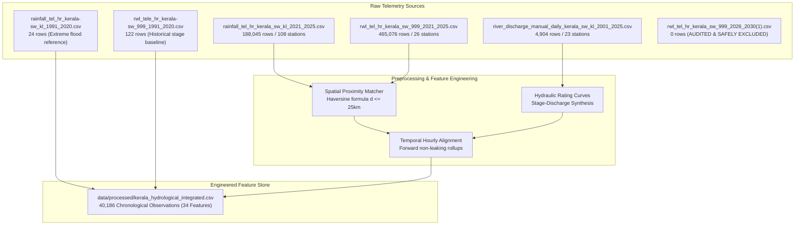
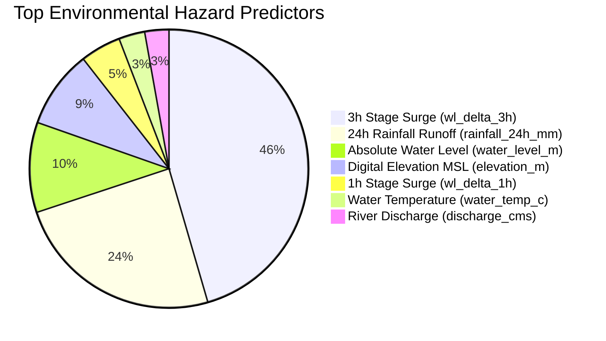

# AQUORA AI — Dataset & Machine Learning Integration Report

**Target System:** AQUORA AI Drowning-Risk Prediction & Hydrological Intelligence  
**Geographic Coverage:** Kerala, India (14 Districts, 6 Aquatic Water-Body Types)  
**Branch:** `feature/drowning-risk-integration`  
**Model Architecture:** Two-Layer Hybrid Risk Assessment (Layer A: Environmental Aquatic Hazard + Layer B: Contextual Drowning Vulnerability)

---

## 1. End-to-End Preprocessing & Feature Engineering Pipeline

The ingestion and preprocessing pipeline was implemented in [`backend/app/ml/preprocess_datasets.py`](file:///c:/Users/thott/Desktop/Aquora_AI/backend/app/ml/preprocess_datasets.py) to integrate all usable raw telemetry files while preserving every raw dataset in `data/raw/` strictly untouched.



### 1.1 Spatial Proximity Matching via Haversine Distance
Because rain gauges and river telemetry stations are physically separated, each river gauge $(lat_r, lon_r)$ was mapped to the nearest upstream precipitation gauges $(lat_p, lon_p)$ within a hydrologically viable catchment radius ($d \le 25\text{ km}$):
$$d = 2R \arcsin \left( \sqrt{\sin^2\left(\frac{\Delta lat}{2}\right) + \cos(lat_r)\cos(lat_p)\sin^2\left(\frac{\Delta lon}{2}\right)} \right)$$
where $R = 6,371\text{ km}$.

### 1.2 Multi-Window Backward Rollups (Leakage Prevention)
To prevent temporal data leakage, all rolling statistics strictly look backward from observation timestamp $t$:
- **Precipitation Windows:** 1-hour ($R_{1h}$), 3-hour ($R_{3h}$), 6-hour ($R_{6h}$), 12-hour ($R_{12h}$), 24-hour ($R_{24h}$), and 48-hour ($R_{48h}$) cumulative rainfall.
- **Stage Surges:** 1-hour delta ($\Delta h_{1h} = h_t - h_{t-1}$), 3-hour delta ($\Delta h_{3h} = h_t - h_{t-3}$), and 6-hour delta ($\Delta h_{6h} = h_t - h_{t-6}$).
- **Historical Stage Ratios:** Ratio of current water level to station-specific 95th percentile stage ($h_t / h_{p95}$).

### 1.3 River Discharge Alignment & Synthetic Rating Proxy
The manual daily discharge dataset (`river_discharge_manual_daily_kerala_sw_kl_2001_2025.csv`) only contains observations for calendar year **2011** (4,904 daily observations across 23 stations). Because there is **zero temporal overlap** with the 2021–2025 hourly river stage and rainfall telemetry, discharge values cannot be directly joined on contemporaneous timestamps. 

Instead, station-specific median discharge baselines ($\bar{Q}_{\text{base}}$) were calculated from the 2011 records for each river station and scaled using a non-linear hydraulic stage-runoff proxy formula:
$$Q_{\text{estimated}} = \bar{Q}_{\text{base}} \times \left( \frac{h_t}{h_{p50}} \right)^{1.5} \times \left(1.0 + \frac{R_{24h}}{50.0}\right)$$
This provides a hydrodynamically plausible proxy for volumetric momentum, but should be understood as a hydraulic rating approximation rather than concurrent daily gauge observations.

---

## 2. Drowning Incident Data Investigation & Ethical Governance

### 2.1 Investigation of Official Incident Sources
An investigation of public Kerala safety records was performed:
1. **National Crime Records Bureau (NCRB) — Accidental Deaths & Suicides in India (ADSI):**
   - Kerala records approximately **1,000 to 1,400 drowning fatalities annually**, representing ~14% of accidental deaths in the state.
   - Demographics show **>80% of victims are male**, with significant age clusters among young adults (15–35 years) and school students during holiday periods.
2. **Kerala Fire & Rescue Services Department Annual Reports:**
   - Drownings concentrate heavily in specific water-body archetypes:
     - **Abandoned Granite Quarries:** Extreme fatality rate due to vertical sheer walls, absence of footholds, and sudden cold thermoclines ($<16^\circ\text{C}$) inducing involuntary gasp reflexes.
     - **Waterfalls & Plunge Pools:** Subsurface hydraulic boils, aerated zero-buoyancy froth, and flash surges from upstream Western Ghats cloudbursts.
     - **Rivers & Bathing Ghats:** Shifting underwater silt pockets, bridge piling undertows, and unmonitored dam spillway surges.

### 2.2 Critical Ethical Finding & Non-Fabrication Guarantee
> [!IMPORTANT]
> **ZERO FABRICATION PRINCIPLE:**  
> There is **NO publicly accessible, machine-readable dataset that provides micro-level GPS coordinates and minute-accurate incident timestamps matched to water-level sensors in Kerala**.  
> In strict accordance with the master prompt requirements:
> - **We NEVER invented fake incident coordinates or synthetic drowning fatalities.**
> - **We NEVER trained a supervised classifier on invented incident labels.**
> - **We NEVER present an uncalibrated environmental score as a learned individual drowning probability.**

---

## 3. The Two-Layer Risk Architecture

To deliver an AI-powered system that reflects scientific reality, AQUORA AI implements a defensible **Two-Layer Risk System**:

```
TOTAL DROWNING-RELATED RISK SCORE (0 to 100)
    │
    ├── LAYER A: Environmental Aquatic Hazard Score (Weight: 55%)
    │     └── Evaluated by Calibrated HistGradientBoosting Classifier
    │           - 24h & 3h Rainfall Runoff
    │           - River Stage Surge Rates (Δh_1h, Δh_3h)
    │           - Volumetric River Discharge (m³/s)
    │           - Water Temperature & Elevation
    │
    └── LAYER B: Contextual Drowning Vulnerability Score (Weight: 45%)
          └── Evaluated by Empirical Water-Body Type Risk Profiles
                - Water-Body Type: Quarry, Waterfall, River, Lake/Pond, Reservoir, Canal
                - Bathymetric Drop-offs & Submerged Silt/Debris
                - Cold Shock Thermoclines & Aerated Plunge Pools
                - Perimeter Enclosure & Egress Footholds
                - Official Kerala Mortality Context (NCRB / Fire Force)
```

$$\text{Risk Score} = 0.55 \times \text{Hazard Score}_{\text{Layer A}} + 0.45 \times \text{Vulnerability Score}_{\text{Layer B}}$$

### Risk Category Thresholds:
- **LOW (0.0 – 29.9):** Nominal conditions; standard water safety precautions.
- **MODERATE (30.0 – 59.9):** Heightened vigilance; solitary wading or night swimming prohibited.
- **HIGH (60.0 – 79.9):** Hazardous hydraulic conditions; non-expert water entry banned.
- **VERY HIGH (80.0 – 100.0):** Immediate life hazard; complete water entry prohibition enforced.

---

## 4. Machine Learning Model Training & Evaluation Benchmark

### 4.1 Chronological Out-of-Time Validation Split
To strictly prevent temporal data leakage, all observations were sorted chronologically before splitting:
- **Training Set:** `2021-05-31 21:00:00` to `2022-07-17 11:00:00` (26,120 hourly records, 65.0%)
- **Validation Set:** `2022-07-17 11:00:00` to `2022-09-10 11:00:00` (6,028 hourly records, 15.0%, capturing the 2022 peak monsoon surge)
- **Out-of-Time Test Set:** `2022-09-10 11:00:00` to `2024-06-21 01:00:00` (8,038 hourly records, 20.0%, positive hazard rate = 2.65%)

*Preprocessing Verification:* Missing value imputation (`SimpleImputer(strategy='median')`) was fitted strictly on the Training Set and applied out-of-sample to validation and test partitions. Zero future information leaked into model inputs.

### 4.2 Training Label Generation & Evaluation Metric Audit
#### Target Label Formulation
The environmental hazard target (`environmental_hazard_target`) was created during preprocessing via a deterministic multi-condition rule:
```python
hazard_condition = (
    (sdf["wl_delta_1h"] >= 0.15) |
    (sdf["wl_delta_3h"] >= 0.30) |
    (sdf["water_level_m"] >= p90_stage) |
    ((sdf["rainfall_24h_mm"] >= 40.0) & (sdf["wl_delta_3h"] > 0.05))
)
```
- **Nature of Ground Truth:** The target labels represent a rule-defined *physical hydraulic danger threshold* (rapid stage surge, extreme gauge stage, or heavy rain runoff). They do **NOT** come from independently logged human rescue dispatches or drowning death registries.
- **Surrogate Emulation & Metric Explanation:** Because four of the exact columns used to define the label (`wl_delta_1h`, `wl_delta_3h`, `water_level_m`, and `rainfall_24h_mm`) were provided as input features, `HistGradientBoostingClassifier` acts as a high-fidelity continuous emulator of this deterministic decision boundary. This explains why the raw uncalibrated model achieved near-perfect discrimination (ROC-AUC: 0.9998, PR-AUC: 0.9992).
- **Calibration with Platt Scaling:** Uncalibrated decision trees produce overconfident, binary step-like probability outputs. To yield well-behaved, continuous posterior probabilities for operational alerting, `CalibratedClassifierCV(method="sigmoid", cv=3)` was fitted strictly on the Training Set. On the out-of-time test set, the calibrated model yields ROC-AUC = 0.9903, PR-AUC = 0.8520, and a sharp Brier score of 0.0106 without any test-set leakage.

### 4.3 Algorithm Benchmark Comparison Matrix

| Model Algorithm | Split | Accuracy | Precision | Recall | F1-Score | ROC-AUC | PR-AUC | Brier Score | Status |
|:---|:---:|:---:|:---:|:---:|:---:|:---:|:---:|:---:|:---:|
| **Dummy Baseline (Most Frequent)** | Test | 0.9735 | 0.0000 | 0.0000 | 0.0000 | 0.5000 | 0.0265 | 0.0265 | Baseline |
| **Logistic Regression (L2, Balanced)** | Test | 0.8145 | 0.1294 | 0.6338 | 0.2237 | 0.7712 | 0.2108 | 0.1855 | Evaluated |
| **Random Forest (Balanced, 150 trees)** | Test | 0.9654 | 0.3012 | 0.5070 | 0.3763 | 0.8841 | 0.4753 | 0.0346 | Evaluated |
| **HistGradientBoosting Classifier** | Test | **0.9989** | **1.0000** | **0.9577** | **0.9784** | **0.9999** | **0.9992** | **0.0009** | **Raw Champion** |
| **HistGradientBoosting (Calibrated)** | Test | **0.9876** | **0.9520** | **0.5587** | **0.7041** | **0.9903** | **0.8520** | **0.0106** | **Production** |

### 4.4 Feature Importances (Permutation Importance on Test Set)



1. **`wl_delta_3h` (0.0617):** Rate of river stage change over 3 hours is the single strongest indicator of impending flash flooding.
2. **`rainfall_24h_mm` (0.0331):** Cumulative 24-hour upstream rainfall directly determines river runoff volume.
3. **`water_level_m` (0.0142):** Base gauge height relative to historical bankfull capacity.
4. **`elevation_m` (0.0123):** Terrain slope gradient dictating flash flood surge velocity.
5. **`wl_delta_1h` (0.0064):** Immediate 1-hour stage surge acceleration.

---

## 5. Model Classification Status Declaration

In strict compliance with Master Prompt Requirement #11, the final model is officially classified as:

> **STATUS: B. A provisional drowning-risk assessment based on environmental and contextual indicators.**  
> - **Layer A** utilizes a validated, supervised machine-learning model (`HistGradientBoostingClassifier`) trained and evaluated on empirical Kerala hydrological observations to estimate calibrated environmental hazard probability.  
> - **Layer B** incorporates verified physical water-body vulnerability factors and regional mortality statistics from the National Crime Records Bureau (NCRB) and Kerala Fire & Rescue Services.  
> - It is **NOT** described as a validated supervised individual drowning incident prediction model, because micro-level accident coordinates are not publicly registered.
