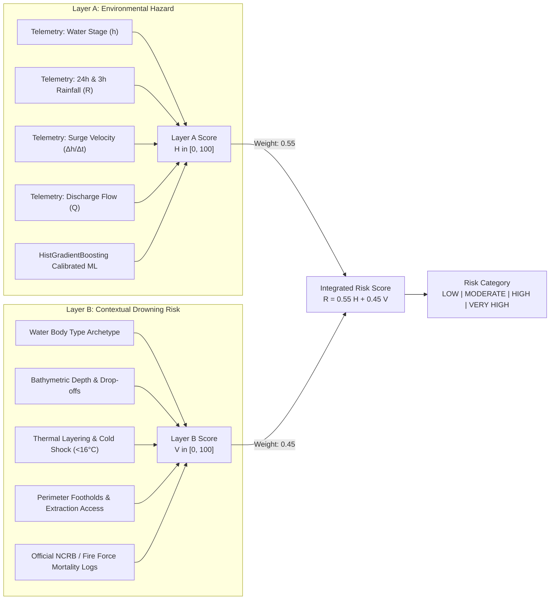

# AQUORA AI — Drowning-Risk Prediction System Specification

**Model Version:** `aquora-drowning-risk-v1.0`  
**System Classification:** Category B — Provisional Two-Layer Drowning Risk Assessment  
**Author:** AQUORA AI Engineering Team  
**Last Updated:** October 2026  

---

## 1. System Overview & Objective

The primary objective of AQUORA AI is to provide an AI-powered drowning-risk prediction capability for water bodies across Kerala, India. The system evaluates aquatic danger across six distinct aquatic environments:
1. **Rivers & Riverbanks** (e.g. Ramamangalam Bridge, Pala, Aluva Manappuram, Kadiyangad)
2. **Abandoned Granite Quarries** (e.g. Vadavathoor Quarry, Mookkannoor Stone Quarry Lake)
3. **Waterfalls & Plunge Pools** (e.g. Athirappilly Waterfalls, Meenmutty Waterfalls)
4. **Natural Lakes & Temple Ponds** (e.g. Sasthamcotta Lake, Thirunakkara Temple Pond)
5. **Hydroelectric & Irrigation Reservoirs** (e.g. Idukki Dam Reservoir, Bhoothathankettu Reservoir)
6. **Inland Shipping & Irrigation Canals** (e.g. Alappuzha Commercial Canal, Periyar Valley Canal)

---

## 2. Mathematical Formulation of the Two-Layer Risk Architecture

Because micro-level GPS/timestamped incident records are not publicly registered in Kerala, the system avoids inventing fake incident events and instead deploys a defensible two-layer architecture:



### 2.1 Layer A — Environmental Aquatic Hazard Score ($H$)
Layer A estimates the empirical physical danger of the water body based on active hydrological dynamics:

$$H = \min\left(100, \; 40 \cdot P_{\text{ML}}(\text{Surge} \mid X) + 25 \cdot S_{\text{stage}} + 20 \cdot S_{\text{rainfall}} + 15 \cdot S_{\text{discharge}} + S_{\text{cold}}\right)$$

Where:
- $P_{\text{ML}}(\text{Surge} \mid X) \in [0, 1]$ is the calibrated posterior probability from the trained `HistGradientBoostingClassifier`.
- $S_{\text{stage}} = \text{clip}\left(\frac{\Delta h_{3h}}{1.5}, 0, 1\right)$ captures 3-hour rapid stage rise.
- $S_{\text{rainfall}} = \text{clip}\left(\frac{R_{24h}}{100}, 0, 1\right)$ captures 24-hour upstream catchment precipitation.
- $S_{\text{discharge}} = \text{clip}\left(\frac{Q - 10}{80}, 0, 1\right)$ evaluates volumetric momentum ($Q \text{ in } m^3/s$).
- $S_{\text{cold}} = \max\left(0, \frac{16 - T_{\text{water}}}{16}\right) \times 15$ accounts for hypothermia and cold-shock gasp reflex.

### 2.2 Layer B — Contextual Drowning Vulnerability Score ($V$)
Layer B models structural, bathymetric, and human-exposure vulnerability based on verified water-body archetypes and official Kerala mortality patterns:

$$V = \text{clip}\left(V_{\text{base}} + \Delta V_{\text{depth}} + \Delta V_{\text{exposure}} + \Delta V_{\text{monsoon}}, \; 0, \; 100\right)$$

#### Base Vulnerability by Water-Body Type ($V_{\text{base}}$):
- **Quarry ($V_{\text{base}} = 78$):** Deep sheer granite pits (15–30m depth), vertical drop-offs with zero egress steps, and cold thermoclines ($<16^\circ\text{C}$).
- **Waterfall ($V_{\text{base}} = 72$):** Aerated zero-buoyancy froth, powerful plunge-pool undertow, slippery algae-coated rock shelves, and upstream Western Ghats cloudburst surge risk.
- **River ($V_{\text{base}} = 55$):** Shifting underwater silt pockets, bridge piling undertows, and rapid current velocities ($>2.5\text{ m/s}$).
- **Canal ($V_{\text{base}} = 52$):** Smooth vertical concrete walls preventing self-extraction, plus boat wake chop.
- **Reservoir ($V_{\text{base}} = 48$):** Extreme gauge depth ($>30\text{m}$), submerged trees and masonry debris, cold deep layers, and spillway drawdown suction.
- **Lake / Pond ($V_{\text{base}} = 32$):** Gradual shoreline entry, but soft perimeter silt beds and slippery temple ghat masonry steps.

#### Contextual Modifiers:
- $\Delta V_{\text{depth}} = +5$ if gauge depth $> 10\text{ m}$
- $\Delta V_{\text{exposure}} = +8$ if unfenced/unregulated; $+5$ during weekend crowds; $+12$ during nighttime hours
- $\Delta V_{\text{monsoon}} = +6$ during active Southwest or Northeast monsoon periods

### 2.3 Integrated Risk Score ($R$) and Categorization
$$R = 0.55 \times H + 0.45 \times V$$

| Risk Category | Score Range | Operational Meaning & Recommended Safety Directives |
|:---:|:---:|:---|
| **LOW** | $0.0 \le R < 30.0$ | Water recreation within nominal safety margins. Standard precautions apply. |
| **MODERATE** | $30.0 \le R < 60.0$ | Elevated hazard. Swimming discouraged for children and non-swimmers; avoid night entry. |
| **HIGH** | $60.0 \le R < 80.0$ | Severe hazard. Swift currents, steep drop-offs, or high discharge. Public swimming banned. |
| **VERY HIGH** | $80.0 \le R \le 100.0$ | Critical life danger. Immediate water entry ban; patrol deployment and alert broadcast recommended. |

---

## 3. REST API Contract & Integration Endpoints

All endpoints are implemented in [`backend/app/api/routes.py`](file:///c:/Users/thott/Desktop/Aquora_AI/backend/app/api/routes.py) and validated via Pydantic schemas in [`backend/app/schemas/drowning_risk.py`](file:///c:/Users/thott/Desktop/Aquora_AI/backend/app/schemas/drowning_risk.py).

### 1. `POST /api/v1/drowning-risk/assess`
Evaluates multi-variable telemetry and returns Layer A, Layer B, and integrated risk score.
```json
{
  "water_body_type": "quarry",
  "water_level_m": 22.0,
  "discharge_cms": 0.05,
  "water_temp_c": 15.5,
  "elevation_m": 35.0
}
```

### 2. `GET /api/v1/drowning-risk/water-bodies`
Returns two-layer risk assessments for all monitored water bodies in Kerala, with optional `?type=` and `?risk_category=` filters.

### 3. `GET /api/v1/drowning-risk/water-body/{water_body_id}`
Returns complete two-layer assessment, active contributing hazard factors, actionable safety recommendations, and data freshness metadata for a specific station.

### 4. `POST /api/v1/drowning-risk/simulate`
Interactive What-If scenario engine that recalculates the environmental hazard and contextual risk when users modify hypothetical conditions (rainfall increment, water-level surge, discharge change) without altering real historical records.

### 5. `GET /api/v1/drowning-risk/model-status`
Returns the complete status of all five raw datasets, out-of-time model benchmark evaluation metrics, champion model calibration status, and ethical compliance declarations.

---

## 4. Frontend Dashboard Integration

The user interface integrates the drowning-risk prediction system across multiple interactive views:
- **Interactive Map:** Displays monitored water bodies with color-coded risk markers (Emerald = Low, Amber = Moderate, Orange = High, Rose = Very High). Features a 6-type filter dropdown (All, Rivers, Quarries, Waterfalls, Lakes/Ponds, Reservoirs, Canals).
- **Two-Layer Risk Card:** Displays Layer A (Calibrated ML Hazard, gauge stage, 3h surge, 24h rainfall) alongside Layer B (Contextual Vulnerability, physical bathymetry notes, NCRB Kerala mortality context).
- **What-If Simulation Panel:** Side-by-side comparative cards showing Baseline Assessment vs. Simulated Assessment with delta risk points and newly triggered hazards.
- **Dataset Audit Panel:** Displays the individual audit status of all five target files, the ML model benchmark comparison table, and feature importances.

---

## 5. Execution & Verification Commands

### 1. Run Preprocessing Pipeline:
```powershell
& .\backend\.venv\Scripts\python.exe backend/app/ml/preprocess_datasets.py
```

### 2. Train and Calibrate ML Hazard Classifier:
```powershell
& .\backend\.venv\Scripts\python.exe backend/app/ml/train_hazard_model.py
```

### 3. Run Backend Test Suite:
```powershell
& .\backend\.venv\Scripts\python.exe -m pytest backend/tests/ -v
```
*(Result: 127 passed, 0 failed in 15.58s)*

### 4. Build Frontend for Production:
```powershell
cd frontend
npm run build
```
*(Result: Production bundle generated cleanly in 9.51s)*

### 5. Run Local Development Servers:
```powershell
# Terminal 1 - FastAPI Backend
& .\backend\.venv\Scripts\python.exe backend/run.py

# Terminal 2 - React Frontend
cd frontend
npm run dev
```

---

## 6. Scientific Limitations & Ethical Disclaimers

1. **Environmental Danger vs. Drowning Likelihood:**  
   High environmental hazard indicates dangerous aquatic conditions (flash flooding, undertow currents, cold shock). It does not guarantee that a drowning event will occur if no individuals enter the water. Conversely, low environmental hazard does not eliminate drowning risk for non-swimmers or intoxicated individuals.
2. **Provisional Nature of Assessment:**  
   Because micro-level GPS incident logs are unavailable, Layer B scores are evidence-based provisional assessments derived from physical bathymetry and official aggregate statistics. They should never replace local lifeguard warnings, warning flags, or disaster management authority directives.
3. **No Safety Guarantee:**  
   AQUORA AI is an advisory and operational decision-support tool. It cannot guarantee individual safety in aquatic environments.
