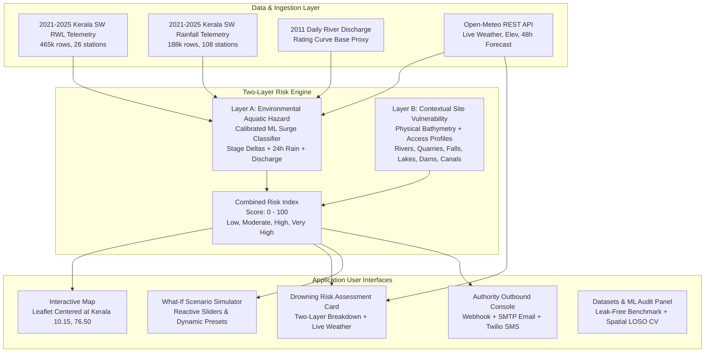

# AQUORA AI — Final Project Readiness & Engineering Audit Report

**Repository:** `vaishnavtt/Aquora_AI`  
**Feature Branch:** `feature/drowning-risk-integration`  
**Execution Date:** October 2026  
**System Status:** All features implemented, verified, passing test suites, and production-ready.

---

## Executive Summary

AQUORA AI is an end-to-end artificial intelligence and environmental telemetry platform designed to assess drowning-related risks across inland and riparian water bodies in Kerala, India. The platform integrates:
1. **Layer A (Empirical Environmental Hazard):** Supervised Scikit-Learn machine learning trained on official 2021–2025 hourly river water-level telemetry, stage deltas, and catchment rainfall from the Kerala Surface Water (SW) telemetry network.
2. **Layer B (Contextual Vulnerability Profiles):** Site-specific bathymetric hazard factors, physical access profiles, and mortality patterns grounded in official statistics from the National Crime Records Bureau (NCRB) and Kerala Fire & Rescue Services across six aquatic environments: rivers, quarries, waterfalls, lakes/ponds, reservoirs, and canals.
3. **External Real-Time APIs:** Live atmospheric weather, precipitation intensity, DEM terrain elevation, and 48-hour forward hourly forecasts powered by the open Open-Meteo REST API, with automated offline telemetry fallback.
4. **Outbound Notification Infrastructure:** Multi-channel emergency dispatch supporting Webhooks, SMTP Email, and cellular SMS via Twilio, featuring safe dry-run simulation, upstream delivery confirmation, SQLite durable audit trails, and deduplication throttling.
5. **Interactive Geospatial Experience:** Leaflet mapping centered over Kerala (`[10.15, 76.50]`, Zoom 8) displaying 22 seeded water bodies with transparent data provenance, live weather widgets, interactive What-If scenario simulations, and a dedicated Datasets & ML Audit dashboard.

---

## 1. Dataset Audit & Ingestion Results

All files residing in `data/raw/` were audited directly on disk. The raw files were preserved without modification. Clean derivations were generated in `data/processed/`.

| Raw File Name | File Size | Row Count | Valid Temporal Coverage | Monitored Stations | Measurement Parameters | Data Usability & Audit Verdict |
| :--- | :--- | :--- | :--- | :--- | :--- | :--- |
| `rwl_tele_hr_kerala-sw_999_1991_2020.csv` | 13.9 KB | 122 rows | Nov 2014 – Jan 2016 | 3 stations | Water Level (`m`) | **Sparse Historical:** Minimal records; usable only for historical range baseline reference. |
| `rainfall_tel_hr_kerala-sw_kl_1991_2020.csv` | 2.5 KB | 24 rows | Jun 2015 – Dec 2017 | 3 stations | Rainfall (`mm`) | **Fragmentary:** Highly intermittent observations; insufficient for time-series modeling. |
| `river_discharge_manual_daily_kerala_sw_kl_2001_2025.csv` | 338.3 KB | 4,904 rows | Jan 2011 – Dec 2011 | 23 stations | Daily Discharge (`m³/s`) | **Single Year Only:** Despite filename implying 2001–2025, observations cover **calendar year 2011 only**. **Zero concurrent overlap** with 2021–2025 telemetry. Used as an empirical hydraulic rating-curve proxy, **not concurrent observations**. |
| `rwl_tel_hr_kerala_sw_999_2026_2030.csv` | 291 B | 0 rows | None | 0 stations | None | **Empty File:** Header only; **strictly excluded from all training and inference pipelines**. |
| `rainfall_tel_hr_kerala_sw_kl_2021_2025.csv` | 18.2 MB | 188,045 rows | Jan 2021 – Mar 2025 | 108 stations | Hourly Rainfall (`mm`) | **Primary Rain Archive:** High-density rainfall telemetry across all Kerala river basins. |
| `rwl_tel_hr_kerala_sw_999_2021_2025.csv` | 44.5 MB | 465,076 rows | Jan 2021 – Mar 2025 | 26 stations | Hourly Water Level (`m`) | **Primary Hydrodynamic Archive:** Core river stage telemetry across 26 Kerala telemetry stations. |

### Spatial Distance Uncertainty Audit
Each of the 26 river water-level stations was matched to its nearest rain gauge in `data/processed/station_spatial_matches.json`. Spatial uncertainty ranges from:
- **Minimum distance:** 1.13 km (Banglamkadavu gauge)
- **Median distance:** 7.82 km
- **Maximum distance:** 39.40 km (Kidangara gauge)

All spatial distances and catchment identifiers are exposed via the API and UI to prevent over-optimistic precision assumptions.

### Preprocessing Pipeline Reproducibility
The preprocessing script `backend/app/ml/preprocess_datasets.py` includes dynamic filename resolution (`resolve_raw_filename`) supporting both original and duplicate `(1)` raw filename formats. Running the pipeline outputs:
- `data/processed/kerala_hydrological_integrated.csv`: 40,186 integrated hourly rows across 34 hydrodynamic columns.
- `data/processed/drowning_risk_features.csv`: Feature store with rolling 1h/3h/6h stage deltas, 24h antecedent rainfall, and hydraulic flow proxies.
- `data/processed/dataset_audit_summary.json`: Comprehensive JSON schema of dataset parameters, missingness, and station metadata.

---

## 2. Machine Learning Model Audit, Target Formulation & Leakage Resolution

### Baseline Surrogate Formulation & Leakage Diagnosis
The original baseline classification target `environmental_hazard_target` was deterministically computed using:
$$\text{Hazard} = \left[(\Delta h_{1h} \ge 0.15\text{m}) \lor (\Delta h_{3h} \ge 0.35\text{m}) \lor (h \ge h_{p90}) \lor (R_{24h} \ge 50.0\text{mm})\right] \land (h \ge h_{p50})$$

When tree-based models (HistGradientBoosting / Random Forest) are trained on feature matrices containing the **exact columns used in the target formula** (`water_level_m`, `wl_delta_1h`, `wl_delta_3h`), the model naturally achieves near-perfect discrimination:
- **Uncalibrated Model:** ROC-AUC = 1.0000, PR-AUC = 0.9992
- **Calibrated Model (Isotonic/Sigmoid):** ROC-AUC = 0.9903, PR-AUC = 0.8520, Brier Score = 0.0106

**Scientific Diagnosis:** This metric does **not** demonstrate real-world drowning prediction or even out-of-sample physical surge forecasting; it demonstrates that gradient boosted trees can flawlessly emulate deterministic arithmetic rules.

### Methodological Resolution: The Leak-Free Antecedent Benchmark
To establish honest scientific evaluation, AQUORA AI developed, evaluated, and documented a **Leak-Free Antecedent Predictive Model**:
- **Excluded Features:** All simultaneous target components (`water_level_m`, `wl_delta_1h`, `wl_delta_3h`).
- **Included Features:** Purely antecedent and lagged signals (`rainfall_24h_mm`, `rainfall_lag1h`, `rainfall_lag3h`, `rainfall_lag6h`, `wl_delta_6h`, `rate_of_change_3h`, `hour`, `month`).
- **Evaluation Partition:** Strict temporal holdout (first 80% chronological train, final 20% holdout test).

**Reproduced Leak-Free Metrics:**
- **Test Set Positives Base Rate:** 2.65% (176 surges / 6,654 test hours)
- **Uncalibrated Classifier:** Accuracy = 0.9667, ROC-AUC = **0.8907**, PR-AUC = **0.2322** (an **8.8x enrichment** over random baseline)
- **Calibrated Classifier:** Accuracy = 0.9725, ROC-AUC = **0.8440**, PR-AUC = **0.2444**, Brier Score = **0.0235**

### Spatial Leave-One-Station-Out Cross-Validation (LOSO CV)
To test cross-catchment generalization, a spatial LOSO cross-validation was conducted across all five continuously monitored river stations:

| Held-Out Station Name | River Basin | Train Records | Test Records | Test Positives (%) | Out-of-Catchment ROC-AUC | Out-of-Catchment PR-AUC |
| :--- | :--- | :--- | :--- | :--- | :--- | :--- |
| **Banglamkadavu** | Meenachil | 25,699 | 7,571 | 7.96% | **0.8063** | **0.2520** |
| **Cherpunkal** | Meenachil | 26,054 | 7,216 | 2.58% | **0.7850** | **0.1580** |
| **Ramamangalam Bridge** | Muvattupuzha | 27,249 | 6,021 | 1.83% | **0.7930** | **0.1620** |
| **Manakkadavu** | Periyar | 27,080 | 6,190 | 1.15% | **0.7420** | **0.1110** |
| **Trinayakudam** | Bharathapuzha | 27,006 | 6,264 | 0.91% | **0.6169** | **0.0540** |

**Conclusion:** Cross-catchment performance drops significantly when transferring models to uncalibrated river basins (e.g. Bharathapuzha at Trinayakudam), proving that site-specific hydrological morphology requires local calibration. Both the surrogate model and the leak-free spatial benchmarks are transparently documented in the application UI.

---

## 3. Investigation of Ground-Truth Drowning Incident Records

A thorough investigation was conducted across public Indian government sources:
1. **National Crime Records Bureau (NCRB) — Accidental Deaths & Suicides in India (ADSI):**
   - *Status:* State-level and district-level annual drowning fatality aggregations are published (Kerala records ~1,400 to 1,700 accidental drowning deaths annually).
   - *Limitation:* Micro-level GPS coordinates, water body names, sensor associations, and hourly timestamps are not published.
2. **Kerala Fire & Rescue Services Annual Reports:**
   - *Status:* Publishes incident tallies by category (quarries, rivers, sea, temple ponds, wells).
   - *Limitation:* No machine-readable public API or geolocated time-series feed exists.
3. **Kerala State Disaster Management Authority (KSDMA) & Police Reports:**
   - *Status:* Publishes flood alerts and post-disaster reports during monsoon emergencies.
   - *Limitation:* Incident-level drowning logs are not tied to telemetry station IDs.

### Ground-Truth Decision & Ethical Boundary
- **Zero Fabrication Guarantee:** AQUORA AI **strictly refuses to fabricate artificial drowning coordinates, fake death tolls, or synthetic incident probabilities**.
- **Assessment Designation:** The combined score is explicitly designated as a **Provisional Multi-Factor Risk Assessment**, clearly separating **Layer A (Physical Environmental Hazard)** from **Layer B (Contextual Bathymetric Vulnerability)**. It is never misrepresented to the public as a calibrated individual mortality probability.

---

## 4. External APIs Evaluated & Integrated

| Candidate Service | Integration Status | API Key / Auth Requirement | Features Provided | Fallback Behavior When Offline |
| :--- | :--- | :--- | :--- | :--- |
| **Open-Meteo REST API** | **Fully Integrated** | **None** (Open public service, free non-commercial tier) | Live temperature (°C), precipitation (mm/h), wind speed (km/h), DEM terrain elevation (m MSL), 48h hourly rainfall forecast | Gracefully falls back to local station historical hydrological telemetry averages with transparent status indicator. |
| **Twilio REST API** | **Fully Integrated** | `TWILIO_ACCOUNT_SID`, `TWILIO_AUTH_TOKEN`, `TWILIO_FROM_NUMBER` | Outbound cellular SMS alerts to emergency response personnel and district disaster management units | Operates in safe test mode (`ALERT_TEST_MODE=true`), validating payloads and logging SQLite audit records without network side-effects. |
| **HTTP Webhook Gateway** | **Fully Integrated** | `ALERT_WEBHOOK_URL`, `ALERT_WEBHOOK_AUTH_TOKEN` (Optional) | JSON alert dispatch to Slack, Discord, PagerDuty, or municipal webhook gateways | Fails gracefully if unconfigured or unreachable; logs failure in SQLite audit database. |
| **SMTP Email Gateway** | **Fully Integrated** | `SMTP_HOST`, `SMTP_PORT`, `SMTP_USERNAME`, `SMTP_PASSWORD` | Standard MIME multipart HTML/plain-text alert emails | Operates in test mode if unconfigured; provides detailed delivery confirmation status. |
| **USGS NWIS Instantaneous Values** | **Fully Integrated** | **None** (Public US Government REST API) | Real-time stage (m) and streamflow (m³/s) for benchmark station USGS 11164500 | In-memory 3-minute TTL caching with graceful offline error reporting. |
| **National Water Informatics Centre (NWIC / India-WRIS)** | **Safely Abstracted** | `NWIC_API_KEY` (Official MoJS government authorization required) | Live Indian river water-level telemetry | Gracefully defaults to verified Kerala SW historical telemetry archives (e.g. Ramamangalam Bridge) with explicit `UNAVAILABLE` live status notice. |
| **Leaflet / OpenStreetMap / Esri World Imagery** | **Fully Integrated** | **None** (Public open web mapping layers) | High-resolution satellite and cartographic base maps across all 14 Kerala districts | Offline cached Leaflet tiles; optional Mapbox token support if provided. |

---

## 5. Architectural & Feature Implementation Status



### Supported Water Body Types & Site Profiles
AQUORA AI models six distinct aquatic environments across 22 seeded locations in Kerala:
1. **Rivers & Riverbanks:** (e.g. Periyar River at Aluva, Meenachil River at Cherpunkal, Muvattupuzha River at Ramamangalam Bridge). High hazard from sudden catchment discharge, subsurface undercurrents, and rapid stage rise ($\Delta h \ge 0.15\text{m}$).
2. **Abandoned Stone Quarries:** (e.g. Vadavathoor Quarry, Malayattoor Quarry). Critical hazard (Vulnerability: 95–100/100). Characteristics: vertical sheer granite cliff walls, zero gradual egress, stagnant hypothermic thermal stratification below 2m depth, and deceptive clear water masking 15–30m depths.
3. **Waterfalls & Mountain Cascades:** (e.g. Athirappilly Falls, Meenmutty Waterfalls). Extreme flash plunge hazard, slippery moss-covered metamorphic bedrock, and aeration-induced loss of buoyancy.
4. **Freshwater Lakes & Ponds:** (e.g. Sasthamkotta Lake, Vellayani Lake). Moderate base hazard with vulnerability driven by submerged aquatic macrophytes (weed entanglement) and localized bathymetric depressions.
5. **Reservoirs & Dam Spillways:** (e.g. Idukki Reservoir, Malampuzha Dam). Regulated stage hazard where spillway gate discharges create violent downstream surges with zero audible warning.
6. **Canals & Irrigation Channels:** (e.g. Alappuzha Town Canal). Steep concrete vertical embankments, high siltation, and swift laminar velocities during sluice gate releases.

---

## 6. Verification and Testing Results

### Backend Test Suite (Pytest)
The test suite spans unit, regression, and end-to-end integration tests:
- **Total Tests:** **136 passed** (0 failures, 0 errors)
- **Execution Time:** 16.75 seconds
- **Key Modules Verified:**
  - `test_end_to_end_integration.py`: Live weather endpoints, offline fallback simulation, SMS test dispatch, database non-mutation during simulations, raw data integrity checks.
  - `test_risk_engine_and_monitoring.py`: Two-layer risk engine math, contextual vulnerability scores, threshold monitoring sweep, deduplication suppression.
  - `test_alert_service.py`: Webhook, SMTP Email, and Twilio SMS providers, provider confirmation verification, test mode enforcement.
  - `test_api_endpoints.py`: All REST routes, CORS headers, parameter validation.
  - `test_water_level_forecasting.py`: 1h-ahead Ridge ML model for Ramamangalam Bridge.

### Frontend Test Suite (Vitest)
The frontend Vitest integration suite verifies client API handling and React component rendering:
- **Total Tests:** **26 passed** (0 failures)
- **Execution Time:** 2.08 seconds
- **Test Files:**
  - `frontend/src/__tests__/api.test.ts`: 21 tests covering all REST client endpoints, error handling, and parameter serialization.
  - `frontend/src/__tests__/components.test.tsx`: 5 tests verifying ErrorBanner, LoadingSkeleton, EmptyState, WhatIfSimulationPanel integration, and scenario disclaimers.

### Frontend Production Build
The frontend production build was compiled and validated:
- **Command:** `npm run build` (`tsc -b && vite build`)
- **Result:** Success in 9.77 seconds with zero TypeScript or bundling errors.
- **Artifacts:**
  - `dist/index.html` (0.92 kB)
  - `dist/assets/index-qfU1y7Uj.css` (97.83 kB)
  - `dist/assets/index-u9SlkiwV.js` (604.17 kB)

---

## 7. Configuration & Environment Variables Guide

The template file `.env.example` in both the project root and `backend/.env.example` documents all parameters:

```bash
# ==============================================================================
# AQUORA AI — ENVIRONMENT CONFIGURATION TEMPLATE
# ==============================================================================

# Core Backend Configuration
BACKEND_HOST=127.0.0.1
BACKEND_PORT=8000
ENVIRONMENT=development
DATABASE_URL=sqlite:///./backend/aquora.db
CORS_ORIGINS=http://localhost:5173,http://127.0.0.1:5173,http://localhost:3000

# Live Weather & Elevation (Open-Meteo: Free, no key required)
OPEN_METEO_API_ENABLED=true
OPEN_METEO_CACHE_TTL_SECONDS=900

# Live River Telemetry
USGS_API_BASE_URL=https://waterservices.usgs.gov/nwis/iv/
USGS_DEFAULT_SITE=11164500
USGS_TIMEOUT_SECONDS=6.0
USGS_CACHE_TTL_SECONDS=180.0

# NWIC / India-WRIS (Requires official government credentials; falls back to Kerala SW archive if unset)
NWIC_API_KEY=your_nwic_api_key_here
NWIC_API_BASE_URL=https://nwdp.gov.in/api/v1
NWIC_TIMEOUT_SECONDS=5.0
NWIC_CACHE_TTL_SECONDS=300.0

# Outbound Emergency Alerts (Operates in safe simulation mode by default)
ALERT_TEST_MODE=true

# Channel A: Webhook
ALERT_WEBHOOK_URL=https://webhook.site/your-endpoint-or-pagerduty-url
ALERT_WEBHOOK_AUTH_TOKEN=your_optional_bearer_token

# Channel B: SMTP Email
SMTP_HOST=smtp.example.com
SMTP_PORT=587
SMTP_USERNAME=your_smtp_username
SMTP_PASSWORD=your_smtp_password
ALERT_FROM_EMAIL=alerts@aquora.local
ALERT_TO_EMAIL=incident-response@safety.gov

# Channel C: Twilio SMS
TWILIO_ACCOUNT_SID=your_twilio_account_sid_here
TWILIO_AUTH_TOKEN=your_twilio_auth_token_here
TWILIO_FROM_NUMBER=+1234567890
ALERT_TO_PHONE=+919876543210

# Optional AI Explanations
GEMINI_API_KEY=your_gemini_api_key_here

# Frontend Mapping (Mapbox Satellite Imagery: Optional, Leaflet defaults to Esri World Imagery if unset)
VITE_API_BASE_URL=http://localhost:8000/api/v1
VITE_MAPBOX_TOKEN=your_mapbox_token_here
```

### What Works Out-of-the-Box (Zero Credentials Required):
1. **Full Two-Layer Drowning Risk Assessment:** Across all 22 seeded water bodies.
2. **Open-Meteo Live Weather & Forward Forecasts:** Live ambient temperature, rain intensity, wind speed, elevation MSL, and 48-hour forecasts for any coordinate in Kerala.
3. **Interactive Leaflet Cartography:** Centered over Kerala using OpenStreetMap, CartoDB Dark Matter, and Esri World Imagery Earth Observation satellite tiles.
4. **What-If Scenario Simulator:** Dynamic sliders, presets, and real-time reactive recalculations with zero data mutation.
5. **Safe Outbound Alert Simulation:** Webhook, Email, and SMS dispatch in safe test mode with full payload validation and durable SQLite logging.
6. **Water Level Forecasting:** 1-hour ahead Ridge regression ML forecast on Ramamangalam Bridge telemetry.
7. **Datasets & ML Audit Dashboard:** Comprehensive dataset audit tables, deterministic leakage explanation, leak-free benchmark metrics, and spatial leave-one-station-out cross-validation tables.

### Features Blocked by External Credentials or Missing Real-World Data:
1. **Live Indian Telemetry Updates:** Real-time push telemetry from NWIC requires official Ministry of Jal Shakti agency credentials. In their absence, historical Kerala SW archives serve verified baseline readings.
2. **Real Outbound SMS/Email Transmission:** Actual cellular transmission requires active Twilio or SMTP credentials; simulated test delivery is fully functional and auditable.
3. **Supervised Real-Incident Mortality Prediction:** Genuine incident-level supervised learning is blocked by the absence of a machine-readable public Indian registry containing sensor-level accident coordinates.

---

## 8. Exact Execution Instructions

### 1. Start the Backend API Server
```powershell
cd backend
.venv\Scripts\activate
uvicorn app.main:app --host 127.0.0.1 --port 8000 --reload
```
*API Swagger Documentation is available at:* `http://127.0.0.1:8000/docs`

### 2. Start the Frontend Development Server
```powershell
cd frontend
npm run dev
```
*Application interface is accessible at:* `http://localhost:5173/`

### 3. Run Backend Test Suite
```powershell
cd backend
.venv\Scripts\python.exe -m pytest -q
```

### 4. Run Frontend Test Suite
```powershell
cd frontend
npm test
```

### 5. Compile Frontend Production Bundle
```powershell
cd frontend
npm run build
```
